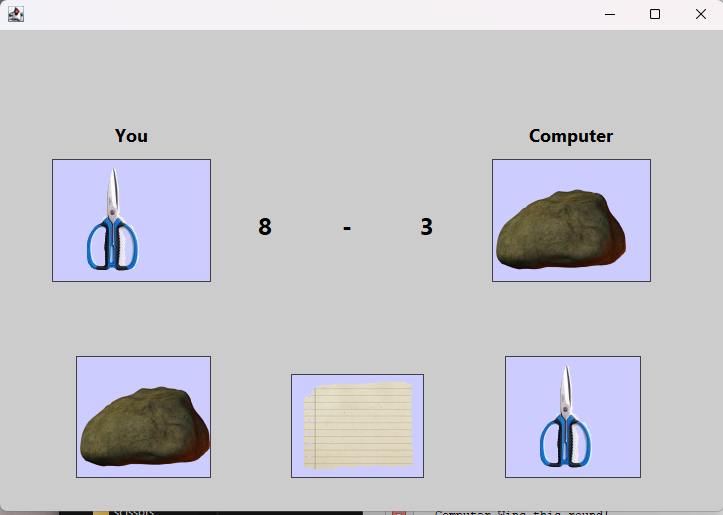

# Rock Paper Scissors GUI Game (Java Swing)

A desktop graphical user interface (GUI) application for the classic **Rock, Paper, Scissors** game built in Java using **Java Swing** and the **NetBeans IDE**.

## 📸 Demo



## 🎮 Features

* **Interactive Swing GUI:** Custom hover effects and border highlights (`MouseAdapter`).
* **Randomized Computer AI:** The computer selects its move dynamically using Java's `Random` class.
* **Dynamic Scoreboard:** Real-time score tracking for both Player ("You") and Computer.
* **Pop-Up Dialogs:** Notifies players of draw rounds using `JOptionPane`.
* **Visual Assets:** Custom image icons representing Rock, Paper, and Scissors.

## 🚀 Getting Started

### Prerequisites

* [JDK 8 or higher](https://www.oracle.com/java/technologies/downloads/)
* [Apache NetBeans IDE](https://netbeans.apache.org/) (Recommended)

### Installation & Execution

1. **Clone the Repository:**
   ```bash
   git clone https://github.com/your-username/rock-paper-scissors-java.git
   ```

2. **Open in NetBeans:**
   * Launch NetBeans IDE.
   * Go to `File` > `Open Project...` and select the project folder.

3. **Build & Run:**
   * Right-click the project in NetBeans and select **Clean and Build** (`Shift + F11`).
   * Run the project by pressing `F6`.

## 🛠️ How It Works

1. **Player Selection:** Clicking on the Rock, Paper, or Scissors label updates your active move.
2. **Computer Turn:** Triggers `executeComputerTurn()`, which picks a random choice (`ROCK`, `PAPER`, or `SCISSORS`).
3. **Winner Evaluation:** The `determineWinner()` method calculates round results:
   * **Rock** beats **Scissors**
   * **Paper** beats **Rock**
   * **Scissors** beats **Paper**
4. **Score Update:** Scores increment automatically based on the round outcome.

## 👨‍💻 Author

* Developed by **masin**